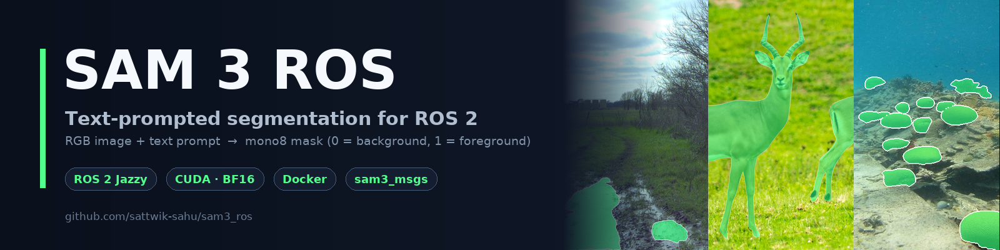
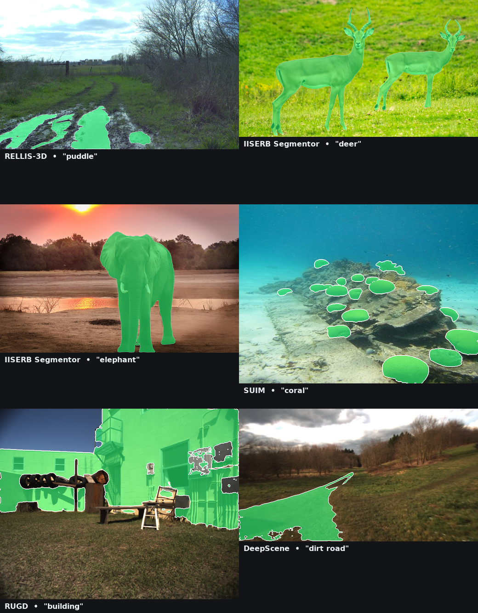

# SAM 3 ROS

**Text-prompted [SAM 3](https://github.com/facebookresearch/sam3) segmentation
for ROS 2 Jazzy.** Give it an RGB image and a prompt; get a binary `mono8` mask
at the input resolution.

[](https://docs.ros.org/en/jazzy/)
[](https://www.python.org/)
[](https://developer.nvidia.com/cuda-toolkit)
[](compose.sam3.yaml)
[](https://sattwik-sahu.github.io/sam3_ros/)
[](src/sam3_ros/LICENSE)

| Node | Interface | Prompt | Output |
| --- | --- | --- | --- |
| `sam3_server` | `sam3_msgs/srv/SegmentImage` | per request | `mono8` mask |
| `sam3_stream` | `sensor_msgs/Image` topic | fixed at startup | `mono8` mask topic |

**Mask contract:** `sensor_msgs/Image`, `encoding: mono8`, exactly the input
width/height, values `{0 = background, 1 = foreground}`, header copied from the
input. Instances are merged into one foreground map; no bounding boxes.

## Quick start

```bash
pixi install -e sam3            # ROS 2 Jazzy + CUDA PyTorch + official SAM 3
pixi run -e sam3 build
export HF_TOKEN=hf_...          # gated facebook/sam3 weights

pixi run -e sam3 ros2 launch sam3_ros sam3_server.launch.py
pixi run -e sam3 python examples/segment_client.py \
    --image frame.jpg --prompt "red mug" --output mask.png
```

Streaming:

```bash
pixi run -e sam3 ros2 launch sam3_ros sam3_stream.launch.py \
    image_topic:=/camera/color/image_raw text_prompt:="red mug"
```

Docker (include-able `compose.sam3.yaml`):

```bash
echo "HF_TOKEN=hf_..." > .env
docker compose -f compose.example.yaml --profile weights run --rm sam3-download
docker compose -f compose.example.yaml --profile server up -d --build sam3-server
docker compose -f compose.example.yaml --profile stream up -d sam3-stream
```

The weights live in the named `sam3-weights` volume; YAML parameters are
bind-mounted at `/config` and can be edited + relaunched without a rebuild.

## Documentation

**Full site: <https://sattwik-sahu.github.io/sam3_ros/>** — built with Zensical
(`pixi run -e docs docs-serve`). Docs live in `docs/`; Zensical has its own pixi
environment and is never installed into the `sam3` environment.

[Install](docs/install.md) · [Server](docs/server.md) ·
[Streaming](docs/streaming.md) · [Parameters](docs/parameters.md) ·
[Docker](docs/docker.md) · [Benchmarks](docs/benchmarks.md) ·
[Examples](docs/examples.md) · [For agents](docs/agents.md)

## Performance

RTX A4500 20 GB · torch 2.13 · CUDA 12.9 · BF16 · 1008² encoder · threshold 0.5.

| Input | p50 | FPS | Peak allocated | Peak reserved |
| --- | ---: | ---: | ---: | ---: |
| 640×480 | 164 ms | 6.1 | 3.9 GB | 4.0 GB |
| 1920×1080 | 172 ms | 5.8 | 3.9 GB | 4.0 GB |
| 3840×2160 | 200 ms | 5.0 | 3.9 GB | 4.5 GB |

Latency is nearly flat because the encoder is fixed at 1008²; only mask
post-processing grows with output size. Model load: 6.7 s, ~3.4 GB allocated.
[Full numbers and charts →](docs/benchmarks.md)

## Examples

[](docs/examples.md)

RELLIS-3D puddles, IISERB wildlife, SUIM coral, RUGD buildings, DeepScene roads —
all from the live ROS service. Prompts and dataset credits in
[Examples](docs/examples.md).

## Repository map

| Path | Contents |
| --- | --- |
| `src/sam3_msgs/srv/SegmentImage.srv` | Service contract. |
| `src/sam3_ros/sam3_ros/sam3_engine.py` | Model load, BF16 inference, prompt cache, mask union. |
| `sam3_server_node.py` / `sam3_stream_node.py` | ROS adapters. |
| `parameters.py`, `config/`, `launch/` | Documented, validated configuration surface. |
| `compose.sam3.yaml` | Include-able server/stream/weights services. |
| `docs/` | Zensical site, benchmarks, examples, agent guide. |
| `scripts/` | `benchmark.py`, `plot_benchmark.py`. |

**Agents:** read [`AGENTS.md`](AGENTS.md) first — invariants, commands, file map,
gotchas. Human orientation: [`docs/agents.md`](docs/agents.md).

## Credits

SAM 3 model and weights: Meta Superintelligence Labs
([facebookresearch/sam3](https://github.com/facebookresearch/sam3)). Efficient
serving pattern adapted from [capgym/cap-x](https://github.com/capgym/cap-x).
ROS 2 environment by [RoboStack](https://robostack.github.io/). MIT license.
