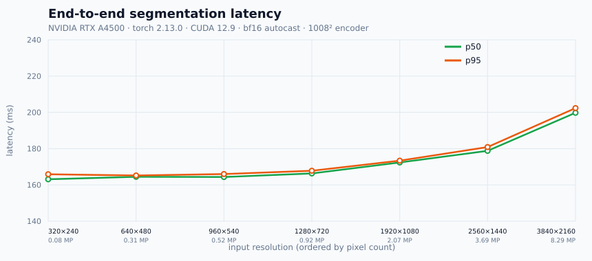
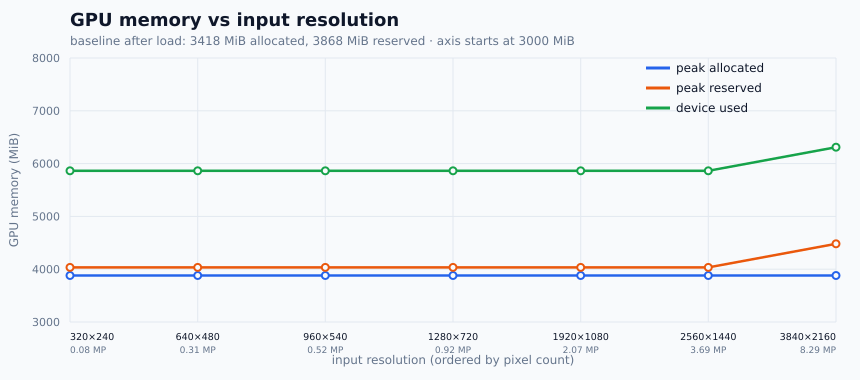

# Benchmarks

Measured on the development machine with the exact engine used by both ROS
nodes (no ROS overhead, no other GPU clients).

| | |
| --- | --- |
| GPU | NVIDIA RTX A4500, **20 GB** |
| Driver / CUDA | 595.99.02 / 12.9 |
| PyTorch | 2.13.0 |
| Precision | BF16 autocast, TF32, cuDNN benchmark |
| Encoder | 1008 × 1008 |
| Threshold | 0.5 |
| Prompt | `"puddle"` (embedding cached) |
| Image | RELLIS-3D `00000/frame000000` |
| Iterations | 15 (plus 2 warmup) per size |

## Latency



| Input | MP | p50 | p95 | FPS | Peak alloc | Peak reserved | Device used |
| --- | ---: | ---: | ---: | ---: | ---: | ---: | ---: |
| 320×240 | 0.08 | 163 ms | 166 ms | 6.12 | 3880 MiB | 4034 MiB | 5863 MiB |
| 640×480 | 0.31 | 164 ms | 165 ms | 6.09 | 3880 MiB | 4034 MiB | 5863 MiB |
| 960×540 | 0.52 | 164 ms | 166 ms | 6.08 | 3880 MiB | 4034 MiB | 5863 MiB |
| 1280×720 | 0.92 | 166 ms | 168 ms | 6.02 | 3880 MiB | 4034 MiB | 5863 MiB |
| 1920×1080 | 2.07 | 172 ms | 173 ms | 5.81 | 3880 MiB | 4034 MiB | 5863 MiB |
| 2560×1440 | 3.69 | 179 ms | 181 ms | 5.58 | 3880 MiB | 4034 MiB | 5863 MiB |
| 3840×2160 | 8.29 | 200 ms | 202 ms | 4.97 | 3881 MiB | 4482 MiB | 6311 MiB |

## GPU memory



After model load: **3418 MiB** allocated, **3868 MiB** reserved, **5695 MiB**
device used (includes the desktop). Model load: **6.7 s**.

## What the numbers mean

* **The encoder dominates.** Every frame is resized to 1008², so p50 latency is
  ~163 ms regardless of input size. The extra 37 ms at 4K is mask
  post-processing (upsampling the union to 3840×2160), not the ViT.
* **VRAM is flat.** Peak PyTorch allocation stays at ~3.9 GB; only reserved
  memory grows (4.03 → 4.48 GB) because the final masks get larger.
* **~5–6 FPS** on an A4500. The streaming node drops stale frames by default, so
  a 30 FPS camera does not build a backlog.
* **Headroom.** ~6.3 GB device usage leaves room for a second model on a 20 GB
  card, but pin the two services to different GPUs (`SAM3_GPUS`,
  `model.device`) if you also run perception/cameras.
* **Cheaper options.** `precision: fp16` reduces activation memory;
  `model.enable_inst_interactivity: false` (default) avoids the interactive
  tracker.

## Reproduce

```bash
pixi run -e sam3 python scripts/benchmark.py \
    --image /path/to/rellis/frame.jpg --prompt puddle --iterations 15
pixi run -e sam3 python scripts/plot_benchmark.py
```

Raw data: [`benchmark.json`](assets/benchmark.json).
