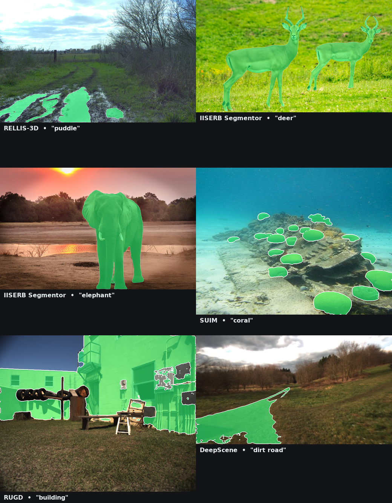
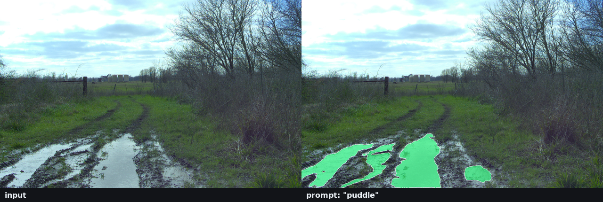
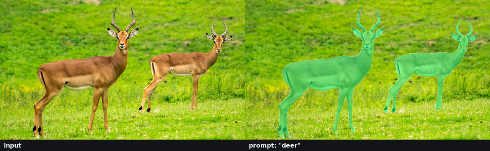
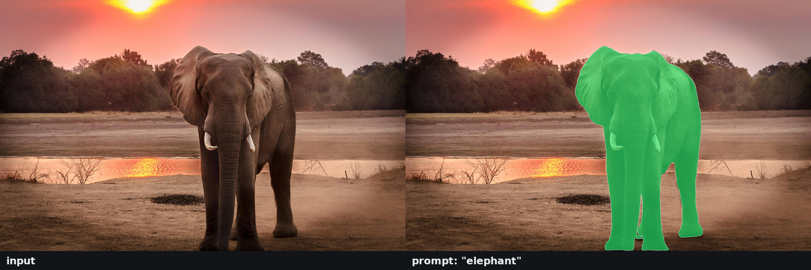
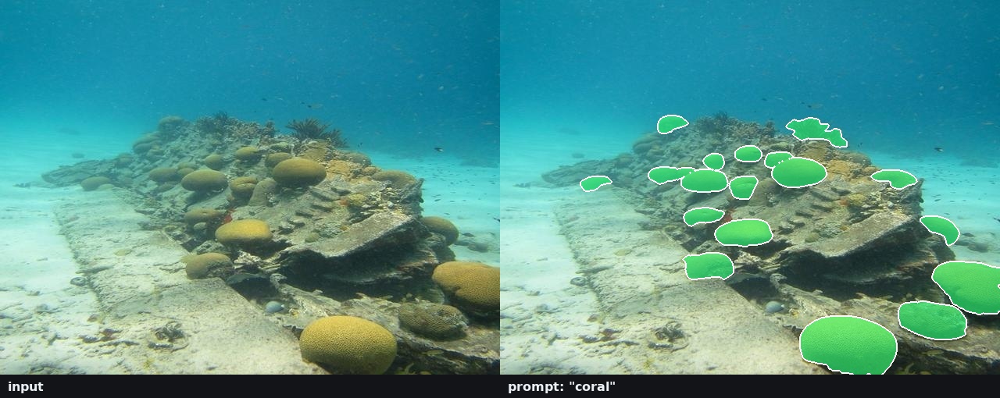
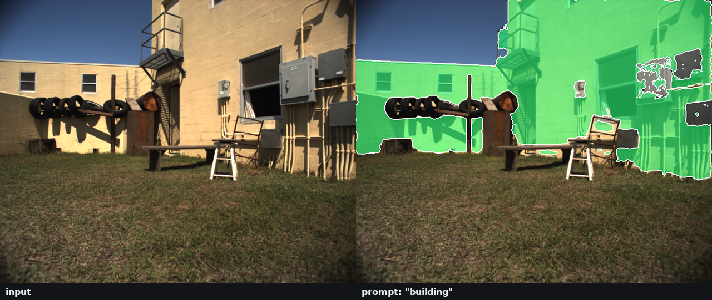
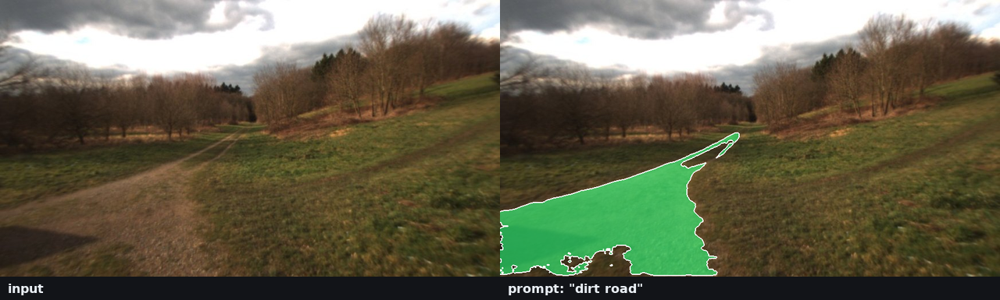

# Examples

All masks below were produced by the live `sam3_server` service through
`sam3_msgs/srv/SegmentImage` on the datasets already on this machine. Green is
foreground (`1`); white outlines are mask boundaries added only for display.



| Dataset | Prompt | Input | Foreground |
| --- | --- | --- | ---: |
| [RELLIS-3D](https://github.com/unmannedlab/RELLIS-3D) | `puddle` | 1920×1200 | 6.59% |
| [IISERB Segmentor](https://github.com/iiserb) | `deer` | 4302×2472 | 17.61% |
| IISERB Segmentor | `elephant` | 3461×2150 | 16.92% |
| [SUIM](https://github.com/ivpml/SUIM) | `coral` | 640×480 | 10.14% |
| [RUGD](https://rugd.goforuto.com/) | `building` | 688×550 | 37.65% |
| [DeepScene](https://deepscene.cs.uni-freiburg.de/) | `dirt road` | 872×485 | 11.91% |

## Side-by-side

=== "RELLIS-3D · puddle"

    

=== "IISERB · deer"

    

=== "IISERB · elephant"

    

=== "SUIM · coral"

    

=== "RUGD · building"

    

=== "DeepScene · dirt road"

    

## Reproduce

```bash
pixi run -e sam3 ros2 launch sam3_ros sam3_server.launch.py &
pixi run -e sam3 python examples/segment_client.py \
    --image /mnt/toshiba_hdd/datasets/rellis-3d/images/00000/pylon_camera_node/frame000000-1581624652_750.jpg \
    --prompt puddle --output /tmp/mask.png
```

Raw metadata for the grid: [`examples.json`](assets/examples.json).

!!! info "Dataset credits"
    RELLIS-3D (University of Nebraska), IISERB Segmentor, SUIM (University of
    Minnesota), RUGD (University of Girona), DeepScene (University of Freiburg).
    Images remain under their original dataset licenses.
