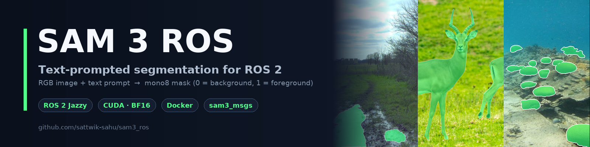
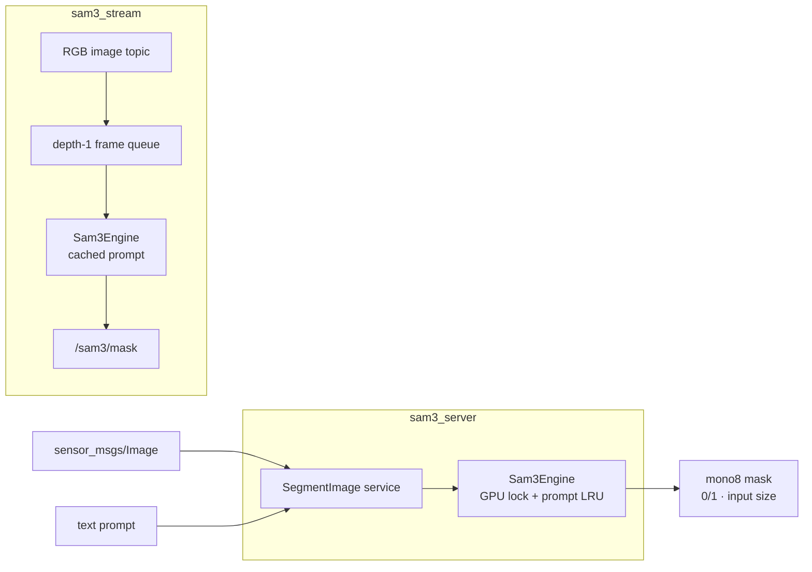
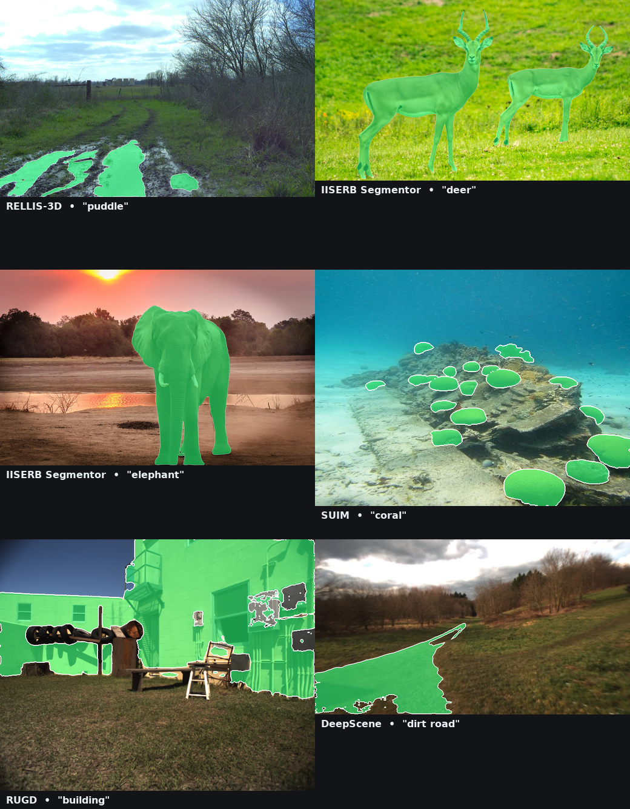

[](https://docs.ros.org/en/jazzy/)
[](https://www.python.org/)
[](https://developer.nvidia.com/cuda-toolkit)
[](docker.md)
[](https://github.com/sattwik-sahu/sam3_ros/blob/main/LICENSE)

**SAM 3 ROS** wraps Meta's [SAM 3](https://github.com/facebookresearch/sam3) in a
production-shaped ROS 2 Jazzy package. Give it an RGB image and a text prompt; it
returns a **binary segmentation mask** at the input resolution.

<div class="grid cards" markdown>

-   **One mask contract**

    `sensor_msgs/Image`, `encoding: mono8`, same width/height as the input,
    values `{0 = background, 1 = foreground}`, header copied from the input.

-   **Two nodes**

    A request/response `SegmentImage` server and a continuous streaming node
    whose prompt is fixed at startup.

-   **Fast path**

    BF16 autocast, TF32, cuDNN autotune, cached prompt embeddings, warmup and a
    latest-frame queue. **~164 ms** at 640×480 on an RTX A4500.

-   **Deployable**

    Include-able `compose.sam3.yaml`, persistent weights volume, runtime-editable
    YAML parameters.

</div>

## Mask contract

```text
request:   sensor_msgs/Image image      # rgb8 / bgr8 / rgba8 / bgra8 / mono8
           string text_prompt           # e.g. "red mug"
           float32 confidence_threshold # < 0 uses the node default
response:  sensor_msgs/Image mask       # mono8, {0,1}, input W×H, same header
           bool success
           string message
```

!!! note "No boxes, no detection lists"
    SAM 3's per-instance masks are merged into the single foreground map. There
    are no bounding boxes in the interface.

## Quick start

=== "Local (pixi)"

    ```bash
    pixi install -e sam3            # ROS 2 Jazzy + CUDA PyTorch + SAM 3
    pixi run -e sam3 build
    export HF_TOKEN=hf_...          # gated facebook/sam3 weights

    pixi run -e sam3 ros2 launch sam3_ros sam3_server.launch.py
    # in another shell
    pixi run -e sam3 python examples/segment_client.py \
        --image frame.jpg --prompt "red mug" --output mask.png
    ```

=== "Docker"

    ```bash
    echo "HF_TOKEN=hf_..." > .env
    docker compose -f compose.example.yaml --profile weights run --rm sam3-download
    docker compose -f compose.example.yaml --profile server up -d --build sam3-server
    docker compose -f compose.example.yaml --profile stream up -d sam3-stream
    ```

Full instructions: [Install](install.md) · [Docker](docker.md).

## Architecture



The shared engine lives in
[`sam3_engine.py`](https://github.com/sattwik-sahu/sam3_ros/blob/main/src/sam3_ros/sam3_ros/sam3_engine.py).
Both nodes are thin ROS adapters around it.

## Performance snapshot

RTX A4500 20 GB · torch 2.13.0 · CUDA 12.9 · BF16 · 1008² encoder · threshold 0.5.

| Input | p50 latency | FPS | Peak allocated | Peak reserved |
| --- | ---: | ---: | ---: | ---: |
| 640×480 | 164 ms | 6.1 | 3.9 GB | 4.0 GB |
| 1920×1080 | 172 ms | 5.8 | 3.9 GB | 4.0 GB |
| 3840×2160 | 200 ms | 5.0 | 3.9 GB | 4.5 GB |

The encoder always runs at 1008×1008, so latency is nearly flat; only mask
post-processing grows with output resolution. VRAM is dominated by the model.

[Full benchmark and charts →](benchmarks.md)

## Examples

[](examples.md)

RELLIS-3D puddles, IISERB wildlife, SUIM coral, RUGD buildings and DeepScene
dirt roads — all produced by the live ROS service. Dataset credits and prompts:
[Examples](examples.md).

## Repository map

| Path | What lives there |
| --- | --- |
| `src/sam3_msgs/srv/SegmentImage.srv` | The only ROS interface (request/response). |
| `src/sam3_ros/sam3_ros/sam3_engine.py` | Model loading, BF16 inference, prompt cache, mask union. |
| `src/sam3_ros/sam3_ros/sam3_server_node.py` | Service node. |
| `src/sam3_ros/sam3_ros/sam3_stream_node.py` | Streaming node + latest-frame worker. |
| `src/sam3_ros/sam3_ros/parameters.py` | Declared, described and validated parameters. |
| `src/sam3_ros/config/*.yaml` | Runtime parameter files (nested, commented). |
| `src/sam3_ros/launch/*.launch.py` | Launch files with documented arguments. |
| `compose.sam3.yaml` | Include-able Docker services (server / stream / weights). |
| `docs/` | This site; `AGENTS.md` is the agent entrypoint. |

## License and credits

MIT. SAM 3 model/weights: Meta Superintelligence Labs
([facebookresearch/sam3](https://github.com/facebookresearch/sam3)). Efficient
serving pattern adapted from [capgym/cap-x](https://github.com/capgym/cap-x).
ROS 2 environment by [RoboStack](https://robostack.github.io/).
